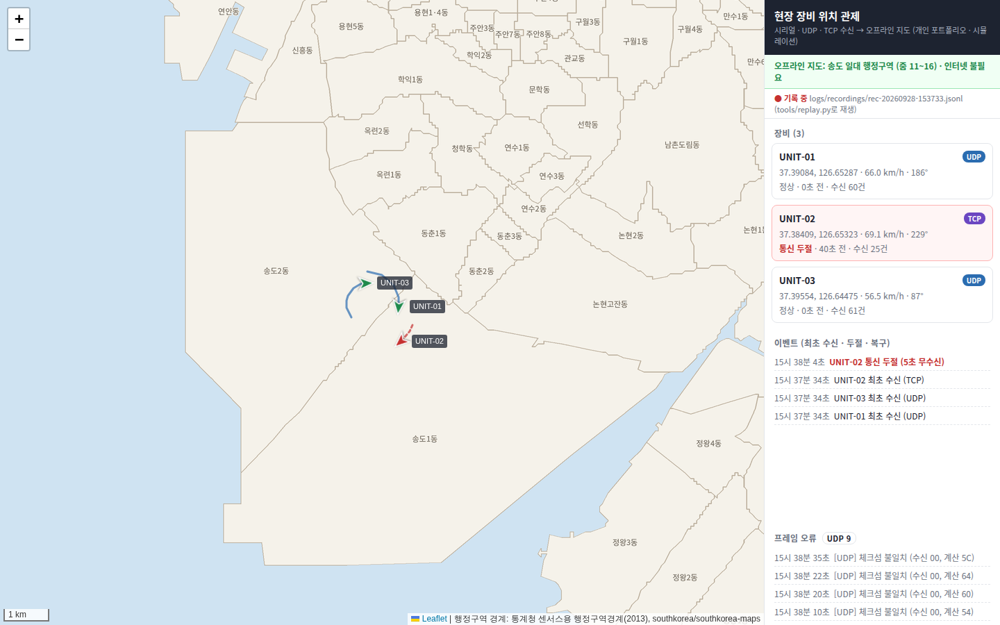

# field-monitor

> **개인 포트폴리오 프로젝트입니다. 실제 장비가 아닌 시뮬레이터로 동작합니다.**

현장 장비가 **시리얼(RS-232C)·UDP·TCP**로 보내는 위치를 받아, **인터넷 없이 동작하는 지도**에 표시하는 관제 프로그램입니다.
받은 프레임을 그대로 기록해 두었다가 **통신 두절·프레임 손상을 섞어 재생**하는 시험 도구가 함께 들어 있습니다.



## 구성

```
[장비] ─ RS-232C ─┐                      ┌─> [기록 JSONL] ──> tools/replay.py (재생 + 이상 주입) ─┐
[장비] ─ UDP ─────┼─> 수신기 ─> sink ────┤                                                     │
[장비] ─ TCP ─────┘      ▲               └─> 트래커 (검증 · 위치 · 두절 판정) ─WebSocket─> 지도 화면
                         └──────────────────────────────── UDP / TCP ───────────────────────────┘
                                                        오프라인 타일(MBTiles) ─> 지도 화면
```

| 파일 | 내용 |
|---|---|
| `fieldmon/protocol.py` | 위치 프레임 `$POS,...*CS` 인코딩·디코딩, XOR 체크섬, 범위 검증 |
| `fieldmon/receivers.py` | UDP · TCP(줄 단위 프레이밍, 길이 제한) · 시리얼(별도 스레드, 자동 재연결) |
| `fieldmon/tracker.py` | 장비별 위치·궤적, 통신 두절·복구 판정, 경로별 오류 집계 |
| `fieldmon/recorder.py` | 받은 프레임을 오류 포함 그대로 JSON Lines로 기록 |
| `fieldmon/app.py` | FastAPI: 웹소켓 갱신, MBTiles 타일 제공 |
| `fieldmon/static/` | 지도 화면 (빌드 없는 HTML/JS, Leaflet 로컬 포함, 외부 요청 없음) |
| `tools/replay.py` | 기록 재생 + 두절·손상·중복 주입 |
| `tools/build_mbtiles.py` | 공개 벡터 데이터 → 오프라인 래스터 지도(MBTiles) |
| `sim/devices.py` | 장비 3대 시뮬레이터 (UDP·TCP·시리얼) |

## 실행

```bash
pip install -r requirements-dev.txt
./demo.sh start          # 서버 + 장비 3대 → http://localhost:8080
```
Docker: `docker compose up --build` 후 `python -m sim.devices`

## 시연 시나리오

| # | 명령 | 보이는 것 |
|---|---|---|
| 1 | `./demo.sh start` | 장비 3대가 경로(UDP·TCP)별로 지도에 표시, 3% 오류 프레임은 버려지고 경로별로 집계 |
| 2 | 20초 대기 | UNIT-02 송신 중단 → 5초 뒤 **통신 두절**(빨간 점선 궤적), 이벤트 기록 |
| 3 | `./demo.sh devices` | 송신 재개 → **통신 복구**와 끊겼던 시간 표시 |
| 4 | `./demo.sh replay` | 방금 기록을 4배속 재생하며 UNIT-01 두절·5% 손상 주입 → 같은 이상이 그대로 재현 |
| 5 | 가상 시리얼 | `socat -d -d pty,raw,echo=0,link=/tmp/ttyV0 pty,raw,echo=0,link=/tmp/ttyV1` 후 서버 `FIELD_SERIAL=/tmp/ttyV1`, 장비 `python -m sim.devices --serial /tmp/ttyV0` |

재생 도구 단독 사용:
```bash
python -m tools.replay logs/recordings/rec-*.jsonl --drop UNIT-02:20-40 --corrupt 0.05 --dup 0.02 --seed 7
```

## 설계 결정

| 문서 | 요지 |
|---|---|
| [0001 오프라인 지도](docs/adr/0001-offline-map.md) | 라이브러리와 타일을 모두 로컬에 둔다. 타일은 공개 데이터를 직접 렌더링해 MBTiles 한 파일로 |
| [0002 파서 하나, 수신 경로 셋](docs/adr/0002-one-parser-three-transports.md) | 수신기는 줄까지만, 검증은 한 곳. TCP 쪼개짐·붙음, 시리얼 스레드, 오류와 이벤트 분리 |
| [0003 기록과 재생](docs/adr/0003-record-replay.md) | 현장 통신 이상을 사무실에서 똑같이 재현. 재생 계획은 순수 함수라 테스트 가능 |

## 테스트

```bash
python -m pytest -q      # 27 passed
```
체크섬·형식·범위 검증, TCP 분할 수신과 길이 초과, UDP 다중 줄, 두절·복구 판정, 오류가 이벤트를 밀어내지 않는지,
타일 y 뒤집기·좌표 투영·MBTiles 생성, 기록 왕복, 재생 계획(배속·두절 구간·손상·중복·seed 재현),
재생 → 실제 소켓 수신 → 두절 판정까지의 끝에서 끝까지 시험. GitHub Actions가 push마다 테스트와 Docker 빌드를 수행합니다.

## 지도 데이터

- 샘플 지도 `data/songdo.mbtiles`는 **통계청 센서스용 행정구역경계(2013)**
  ([southkorea/southkorea-maps](https://github.com/southkorea/southkorea-maps) 제공)를 `tools/build_mbtiles.py`로 렌더링한 것입니다.
  2013년 경계라 이후 매립된 지역은 반영되지 않았습니다. 원천 데이터 일부는 `data/source/`에 있습니다.
- 다른 지역은 GeoJSON을 넣어 다시 만들 수 있습니다:
  `python -m tools.build_mbtiles <geojson> --bbox 서,남,동,북 --zoom 11-16 --font <한글 글꼴> -o data/map.mbtiles`
  후 `MBTILES_PATH=data/map.mbtiles`.
- 공개 타일 서버(OSM 등)에서 타일을 대량으로 내려받는 것은 이용 정책 위반이라 쓰지 않습니다.

## 한계와 다음 단계

- 프레임에 순번·송신 시각이 없어 순서 뒤바뀜·지연은 판정하지 않는다. 필요하면 프레임에 순번 필드를 추가한다.
- 저장소는 파일 기록뿐. 장기 보관·검색이 필요하면 DB로 옮긴다.
- 화면 로그인, 수신 포트 접근 제어는 미적용 (시연용).
